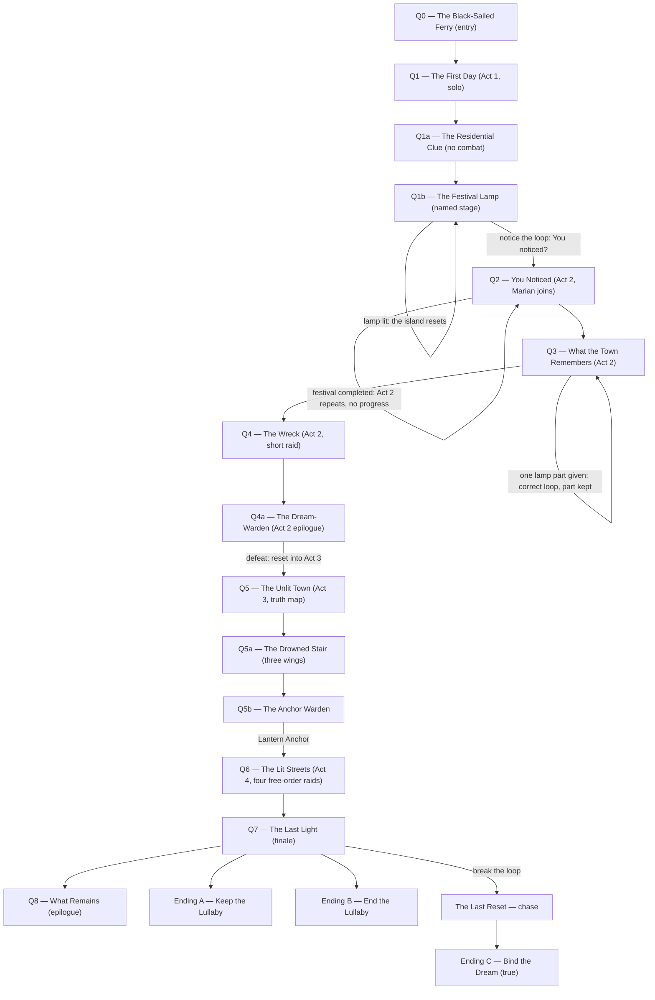

# The Drowned Lantern — Lantern Isle Questline

> *The lighthouse does not warn ships away. It calls them in.*

Status: **proposal / for review** — no code yet.
Locked 2026-11-20: **DLC name is The Drowned Lantern**; delivered as a mod package under
`mods/drowned_lantern/` (see `docs/modding_design.md`); the Sleeper is a **dream leviathan**
(not a Bound Power); the town is **already dead** and persists inside the dream; the
companion is **Marian**, the Keeper's daughter, in Acts 2 and 4 and becomes a **permanent
ally in the Bind ending**; the pack requires **level 40–60**; the **four district raids are free order**, each revealing its own memory;
the optional **repeatable night raids** are post-arc content; the large city map uses
**Option A: Text-widget drag-pan**; the pack toggle is the **Game Rules + one-time old-save
opt-in** model; the arc is a **real loop** — the mandatory **Festival Lamp** stage completes
and resets the island (world progress wipes, player knowledge/items persist, replayed rooms
shrink); Act 2's festival quest is a **trap** (full completion repeats the act with no
progress), while **one harbor-lamp part per loop** is a **correct loop** that tracks
progress; a **Residential Clue** quest precedes the Festival Lamp; **Act 3 opens with the
Dream-Warden's defeat reset**; the **true ending has a chase** that retries from the last
checkpoint; the dock Daughter clue appears in Act 1; the Keeper is already at the edge and
**every ending breaks him** — only the epilogue differs.

Companion docs: `quest_system_design.md` (quest runtime) · `wild_dungeon_design.md`
(site-dungeon loop) · `wonderland_quests_design.md` (state-check side quests) ·
`family_system_design.md` (Game Rules consent pattern) · `event_horizon_design.md`
(site marker + hub) · `karma_system_design.md` §17 (Game Rules framework) ·
`drowned_lantern_dialogue.md` (scene-by-scene dialogue and Keeper encounters) ·
`drowned_lantern_bosses.md` (boss roster, night-warden parity model).

---

## 1. Pitch

A black-sailed ferry offers passage from any port: no crew, no freight, no questions.
Mid-voyage the ship is pulled onto a reef below a dark lighthouse. The player wakes on a
beach where the town is alive, the market is open, and the innkeeper is already setting a
table for a festival that will happen tomorrow. It has been tomorrow for a long time.

The lighthouse is one of the **Nine Lights** — pre-Accord coastal beacons built to keep the
**Sleeper** dreaming. This is the last one still burning, and it burns **inverted**: it does
not guide ships, it pulls them in. The Sleeper is a vast dream leviathan beneath the reef;
it was the dreamer of the deep long before the town. The light is a lens, not a god.

The town died in a single night — the **Ninth Tide**, the wave that rose when the other
eight lights went dark. The Keeper survived because he was inside the lighthouse. He turned
the Ninth Light's lens on the drowned town, and the Sleeper dreamt it back — every street,
every neighbour, every festival banner. The Keeper's wife and daughter died in the same
wave, but they are not the only ones he kept. Everyone is dead. The light is a lullaby.

The Sleeper did not become the town's dreamer. It was always the dreamer of the deep; the
Keeper only turned the lens, and the town became its dream.

Only one of the dead knows it. **Marian**, the Keeper's daughter, has been lucid inside the
dream long enough to see the loop, and she asks the player to **save what is left** — not
the bodies, but the memories. The player must decide what the island becomes: a kind lie, a
grave, or a waystation between the living and the dead.

**Design north star:** keep this arc mechanically distinct from *The Father of Thirst*.
That questline is faction politics and four world-locked endings; this one is isolation,
survival, memory, and one island's three-way fate. Do not repeat the four-ending chassis.

---

## 2. The player's path (plain summary)

0. **Opt in** — the pack requires **level 40+**; new characters choose it in the Game
   Rules step, and old saves get a one-time opt-in at the ferryman. The arc is tuned for
   **level 40–60**; the ferryman refuses below 40 ("the light does not take the green").
   Once the arc starts, the choice is final.
1. **The ferry** — from any port city, alone. Allies are benched, cargo is stowed, the
   player's own ship stays moored. The crash is scripted, not random.
2. **Act 1 — The First Day (solo):** wake on the beach, explore the harbor, and take the
   Keeper's festival task. Ask the residential district for the **Residential Clue** (where
   the lamp parts are, and what the lighthouse is), then complete the **Festival Lamp**
   stage. Completing it is the failure: the lamp lights, the dream "finishes the day," and
   the island resets. On this pass **Marian** sits on the dock and does not respond.
3. **Act 2 — The Second Day (Marian):** wake on the beach again. The girl on the dock looks
   up and says **"You noticed?"** and joins — **Marian**, the Keeper's daughter. The
   festival quest is still there — and completing it just
   repeats Act 2 with no progress. The real path is to collect **one harbor-lamp part per
   loop** (oil, wick, flame); each part completion triggers a **correct loop** that keeps
   the part. After all three parts and **The Wreck** (the beacon lens), the Act 2 epilogue
   plays and the **Dream-Warden** appears. Defeating it resets the island into Act 3.
4. **Act 3 — The Truth (solo):** the Warden's defeat lands in the truth map and an endless
   night. Marian cannot follow. Explore the four ruined districts for the **truth
   keys** (the Keeper's log, Marian's ribbon, the wife's memorial, the ninth lamp),
   open the lighthouse Sanctum, descend its three wings (Archive, Choir, Vault), relight the
   three lamps, defeat the **Anchor Warden**, and recover the **Lantern Anchor**.
5. **Act 4 — The Light (Marian):** the anchor re-manifests her. Clear the four district
   shrines in **any order**; each lights its district, opens its real service, and reveals
   its own memory. Relight the lighthouse and choose the island's fate — or break the
   loop, which triggers the **true-ending chase**.
6. **Epilogue — Dawn:** the island becomes a hub, a grave, or a dream, depending on the
   choice. The Bind ending can make Marian a permanent ally.

---



---

## 3. Lore frame (proposed canon; flag anything to change)

- **The Sleeper** is a vast dream leviathan beneath the reef. It is not a god, not a Bound
  Power, and not malevolent. It was already the dreamer of the deep long before the town;
  the Nine Lights were built to keep it dreaming. It has been asleep since before the
  Accord.
- **The lighthouse** is the aperture that focuses the dream and the lullaby that keeps the
  Sleeper asleep. While the beam burns, the town persists. The light is not a warning;
  it is a lens. The Sleeper is the dreamer; the Keeper is the hand that turns the lens.
- **The Ninth Tide.** The night the town died. The Accord broke; the other eight lights went
  dark; the Sleeper stirred; the sea rose. The town drowned — streets, boats, festival,
  everyone. The lighthouse survived. The Keeper survived because he was inside it. His wife
  and daughter were on the last ship, the *Saltwake*, which broke on the reef.
- **How the dream began.** The Keeper turned the Ninth Light's lens on the drowned town and
  asked the Sleeper to keep it. The Sleeper — already dreaming the deep — dreamt the town
  back. The whole island is the dream, not only the Keeper's family. He feeds it ships and
  fresh memories because the dream needs them to stay bright.
- **The loop** is the dream's defense. When the festival is completed, the dream treats the
  day as finished and resets the island. The Keeper's "mandatory" festival quest is the
  reset trigger; the town repeats because it has done this many times. Only the Daughter
  remembers between iterations.
- **The Nine Lights** were a pre-Accord network of coastal beacons that kept the Sleeper
  dreaming and anchored sea-teleportation. The Accord's breaking darkened most of them;
  this is the last one still burning. The Isle of Glass's "dark lighthouse" is one of the
  eight — a future lore hook, not required for this arc.
- **The Keeper** is alive. He survived the Ninth Tide inside the lighthouse. He turned the
  light's lens on the drowned town and asked the Sleeper to keep it; the Sleeper dreamt the
  whole island back, not just his family. He has lured ships ever since to feed the dream.
  He is the human antagonist; the Sleeper is the engine. He is dying, and he sees the player
  as a replacement anchor.
- **Marian, the Keeper's daughter,** is dead and lucid. She was on the last ship, the
  *Saltwake*; she remembers the water. The dream holds her tightest because her father
  focused on her, so she can see the loop. She wants the player to end the lie. She is the
  Act 2 and Act 4 companion.
- **The townsfolk** drowned in the Ninth Tide and are memory-echoes. They believe they are
  alive; routines repeat; the festival is always tomorrow because the wave is always
  tomorrow; food has no taste. The player's Command Resonance makes them "solid" enough to
  interact, which is why they accept the player as a traveler.
- **"Save what's left"** means the memories, not the bodies. The **Town Ledger** key item
  fills as districts are lit; the endings decide what happens to those memories.
- **The island's fate = the Sleeper's sleep state.** Keep the lullaby, end it, or bind it
  to the beacon network. That is the three-ending spine.

### 3.1 What is true

| In the dream (Acts 1–2) | In the truth (Acts 3–4) |
|---|---|
| The town is alive and busy | The town is ruined and silent |
| The festival is tomorrow | The festival never happened; the Ninth Tide came the night before |
| The town is preparing for a festival | The town drowned — streets, boats, everyone |
| The innkeeper offers a room | The inn has no roof |
| The market sells goods | The stalls hold only salt and bone |
| The lighthouse is dark but "fine" | The lighthouse is a lens; the Sleeper is the dreamer |
| The Keeper is a gracious host | The Keeper is a grieving man feeding ships to a dream |
| The Keeper is keeping his family | The Keeper is keeping the whole drowned island |

The truth does not invalidate the dream: the memories are real, the people were real,
and the grief is real. That is why "save what's left" has weight.

---

## 4. The island and the city map

### 4.1 Identity

- City id: `lantern_isle` — "Lantern Isle"; biome `lantern` (unique, so it never counts
  toward ascension / Wonderland / Pandemonium biome gates by accident). Add a `lantern`
  color to the world-map `_BIOME_COLORS` and keep it out of `BIOME_RACES` / city-dungeon
  spawn pools — the island's enemies come from its own raid pools.
- Hidden from the world map until the player arrives. After the arc it appears as a
  standalone node (outside the region rectangles) and becomes a beacon fast-travel
  destination.
- No normal land or sea connections. Entry is the scripted ferry; exit is the restored
  beacon. Pathfinding, wild-dungeon seeds, and the world map must skip it while hidden.
- **Level gate: 40–60.** The ferryman offers passage only at **level 40+**, and the whole
  arc (Acts 1–4) is tuned for **40–60**: loot, bosses, raid waves and the Sanctum ward all
  scale inside that band. Below 40 the ferryman refuses and the city stays hidden; an old
  save can hold the pack but cannot start the arc. The first Act 4 shrine and the Keeper
  are the ceiling checks — a level-40 party should finish, a level-60 party should have
  room for the optional raids.

### 4.2 Map variants (same geometry)

Two ASCII maps with **identical line/column geometry** so one
`CITY_SERVICE_POSITIONS["lantern_isle"]` entry serves both:

- **Dream map** (`lantern_isle`) — bright, busy, festival banners, shops open in the art
  but closed in the act gate.
- **Truth map** (variant key `truth`, stored as
  `CITY_MAP_VARIANTS["lantern_isle"]["truth"]`) — same streets, ruined roofs, dark
  windows, the bay visible beyond the harbor.

Store variants in a new `CITY_MAP_VARIANTS` dict rather than adding keys to `CITY_MAPS`.
`verify_all_cities_mapped()` and `tests/test_city_service_positions.py` compare
`CITY_MAPS` against `CITIES`; variant keys would show as "extra maps" and break the
equality test. `get_city_map(city_id, variant=None)` checks the variant dict first.
The positions test should gain an explicit variant check (same spans for both maps).

### 4.3 Districts

| District | Shrine tag | Memory (specific to this district) | Warden | Service unlocked |
|---|---|---|---|---|
| **Harbor** | `shrine_harbor` | *The Last Ship* — the Keeper's wife begs him to let the dead go; he refuses | Drowned Sailor | Salvage shop (`shop`) |
| **Market** | `shrine_market` | *The Last Market Day* — the daughter's birthday; the town's last normal day | Hollow Merchant | Forge (`blacksmith`) |
| **Residential** | `shrine_residential` | *The Night of the Wreck* — the daughter drowns; the Keeper makes the pact | Weeping Mother | Inn (`inn`) |
| **Temple** | `shrine_temple` | *The Lullaby* — the town agrees to the dream; the Sleeper's song | The Choir | Memorial (`temple`) |
| **Lighthouse** | `beacon` | *The Keeper's Choice* — the finale | The Keeper | Beacon fast travel |

The four district raids are **free order**. Each memory stands alone; the final lighthouse
scene assembles them in a fixed order (wife → birthday → wreck → lullaby) so the story
lands regardless of clear order.

### 4.4 Act-based section locking

`CityScreen` already builds `closed_services` from `is_service_open`. Add a DLC gate:

- `lantern_phase` = `"dream_day"` (Acts 1–2), `"truth_night"` (Acts 3–4), `"dawn"`
  (post-arc).
- In `dream_day`, all real services are closed; the dream map's labels are visible but
  clicking gives a dream-line ("The stall is shuttered. It has been shuttered for years.").
- In `truth_night`, all services are closed until their district is lit. Shrines are open
  only for the current act's available districts (all four in Act 4).
- Lighting a district adds it to `player["lantern"]["lit_districts"]`; its service opens,
  its map range gains a gold "lit" tag, and its memory is recorded in the Town Ledger.
- The **Lantern Anchor** is the visual and mechanical key: lighting districts is not
  restoring the lie, it is reading the town's memory.

`CityMapWidget` already supports `closed_services` dimming; add `locked_regions` (line/col
spans per district) so the whole district dims, not only its service labels.

### 4.5 Large-map pan (Option A)

The city map is a `tk.Text`. `tk.Text` supports `scan_mark` / `scan_dragto`, so mirror the
world map's pan without a Canvas rewrite:

1. **Decouple widget height from map height.** Today `CityMapWidget` uses
   `height=self._map_lines`; a huge map pushes the action bar off-screen. Set
   `height=min(map_lines, VIEWPORT_LINES)` (e.g. 26) and let the scrollregion carry the
   rest.
2. **Pan handlers.** On `<ButtonPress-1>` → `scan_mark`; on `<B1-Motion>` → after a 4px
   threshold, `scan_dragto(gain=1)` and set cursor `fleur`; on `<ButtonRelease-1>` →
   restore cursor, and if the pointer did not drag, dispatch the service/dungeon tag.
3. **Move service dispatch to release.** Tag clicks currently fire on press. Record the
   press index; on release, if not dragged, hit-test `@x,y` with `tag_names` and dispatch
   the matching service. This is the same pan-vs-click split as
   `world_map_screen._on_canvas_release`.
4. **Only pan when needed.** Compute the content bbox; enable pan/scrollregion only when
   it exceeds the viewport. Zero the centering `lmargin1` when the content is wider than
   the viewport; keep the existing centering when it fits.
5. **Parity keys.** Home recenters; WASD/arrows pan; Tab still switches focus zones.

Keep keyboard facility navigation working. Add a Tk diagnostic for pan + click; do not
depend on pytest for the pointer behavior.

### 4.6 The loop

The arc is a real loop, not a metaphor. The dream resets when the festival completes.

**Trigger.** In Act 1 the Keeper gives the festival task. First the player is sent to the
**residential district** for the **Residential Clue** quest: ask the neighbors where the
lamp parts are (oil at the harbor, wick at the market, flame at the temple) and what the
lighthouse is. The answers repeat, dodge, and hint at the Ninth Light and the Keeper's
girl on the dock. No combat. Only then does the **Festival Lamp** stage open.

The Festival Lamp is its own named stage: gather oil, wick, and a flame, then light the
harbor lamp before the festival. The lighthouse road is blocked until it is done. When the
lamp lights, the quest completes — and the dream treats the day as finished. The screen
whites out; the player wakes on the beach; the town is back at the start. **Completion is
the failure.** The Journal shows the quest as complete, then a `[LANTERN]` event marks it
**FAILED — the day began again** so the player sees the loop rather than mistaking it for a
normal transition. Death is **not** the loop trigger; dying wakes the player at camp
without resetting the day.

**What resets (world progress).** Festival objectives, the harbor lamp, dream district
states, The Wreck's clear state, NPC positions and the Keeper's dialogue, the dream map
variant and its district count, and dream-raid room counts.

**What persists (player knowledge).** Level/XP/gold, inventory (except festival oil/wick/
flame, which are removed), the Town Ledger, the Daughter's trust, the `dock_daughter`
clue flag, and any `loop_proof` key items. Beacon parts already collected are loop-proof —
the dream cannot unmake a thing the player remembers. The player's memory is the weapon;
the loop cannot take it.

**The dock clue.** In Act 1, the harbor dock has a clickable story tag: the Daughter sits
with her feet in the water, does not turn, and does not answer. The tide moves through her
ankles. It is optional, but the Journal records "The Girl on the Dock." On Loop 2 the
same tag is awake: she looks up and says **"You noticed?"** and joins.

**Shrinking stage.** Each reset makes the dream smaller:

| Loop | Dream map | Dream raid rooms | Tone |
|---|---|---|---|
| 1 | 4 districts | — | Golden afternoon; the festival is tomorrow |
| 2 | 3 districts (Residential gone) | 2 rooms | Repeats and blank faces; the Daughter answers |
| 3 | 2 districts (Market gone) | 1 room | Collapse; the Keeper's mask slips; the Daughter forces the move into Act 2 |

The truth map (Acts 3–4) is stable; only the dream shrinks. Replayed dream raids use
`max(1, base_rooms - (loop - 1))`; the Act 4 district shrines are outside the loop and keep
their full size. The loop is capped at three iterations: on the third the Daughter opens
the dock path and forces the move into Act 2, so the player can never dead-end.

**No dead-ends.** Location objectives inside the loop are **knowledge-based**: once a site
is visited in any iteration, it stays done in `loop_proof`. The shrink order is Residential
→ Market; the Harbor and Temple never collapse before their required memories are recorded.
On Loop 3 the Daughter's forced exit fills in any missing location she remembers, so
no objective can become unreachable. The same applies to **parts**: if a part's district
has collapsed, the Daughter recovers it from memory in a short scene — no harbor-lamp part
is permanently missable. The Daughter stays joined across resets — she is loop-proof — and
the `dock_daughter` clue flag persists.

**The broken reset (Act 2 → 3).** After the Wreck and the Act 2 epilogue, the Keeper's
dream sends the **Dream-Warden**. When the Warden falls, its death-reset is the one the
truth can break: the player carries the parts, the lens, the clues, and the Daughter's
memory. The town stutters between dream and ruin; the illusion breaks; the truth
map/endless night appears. This is the Act 3 opening, and it is why Act 3 is another loop
rather than a clean cut.

**Act 2 — wrong loops vs correct loops.** The festival quest remains available in Act 2.

- **Wrong loop:** completing the whole festival quest (all three parts + lighting) repeats
  Act 2 from the beginning with **no progress**. `wrong_loops` increments; the Keeper
  pretends nothing happened, the residents repeat themselves, and the Daughter grows
  sharper. At 3 wrong loops the Daughter blocks the festival route and the residents refuse
  to help until the player tries the correct path. This is the punishment for not paying
  attention — time, not a game over.
- **Correct loop:** collecting **one** harbor-lamp part (oil at the harbor, wick at the
  market, flame at the temple) and stopping there triggers a reset that **keeps the part**.
  `correct_loops` increments; the next part becomes available; the Daughter says the loop
  keeps what the player learns. Three correct loops = all three parts.
- **Why it works:** the dream resets when the lamp is *completed*, not when a part is
  *given*. Giving one part at a time turns the loop into a checkpoint. The player has to
  notice the difference — that is the Act 2 test.
- **After the three parts:** clear The Wreck for the beacon lens, play the Act 2 epilogue,
  and fight the **Dream-Warden**. Its defeat triggers the reset into Act 3.

**Why the shrink exists.** It is both thematic (the lie is running out of room) and a
pacing concession: the reset wipes world progress, so the replay is deliberately shorter.
Never wipe player XP, inventory, or the Ledger; only the dream's stage resets.

---

## 5. Dungeons and raids

### 5.1 Instances

| Instance | Act | Companion | Length | Warden | Completion reward |
|---|---|---|---|---|---|
| **The Wreck** | 2 | Marian | 2 rooms (base 3, reduced by loop) | Drowned Quartermaster | beacon lens, stowed cargo |
| **The Dream-Warden** | 2 | Marian | story arena | Dream-Warden | Act 3 reset |
| **The Unlit Town** | 3 | Solo | 4 district memory scenes + short echoes | — | 4 truth keys |
| **The Drowned Archive** | 3 | Solo | 3–4 rooms | The Archivist | first lamp |
| **The Choir** | 3 | Solo | 3–4 rooms | The Cantor | second lamp |
| **The Anchor Vault** | 3 | Solo | 3–4 rooms | The Anchor Warden | third lamp + Lantern Anchor |
| **Harbor Shrine** | 4 | Marian | 3 rooms + boss | Drowned Sailor | lights Harbor; salvage shop |
| **Market Shrine** | 4 | Marian | 3 rooms + boss | Hollow Merchant | lights Market; forge |
| **Residential Shrine** | 4 | Marian | 3 rooms + boss | Weeping Mother | lights Residential; inn |
| **Temple Shrine** | 4 | Marian | 3 rooms + boss | The Choir | lights Temple; memorial |
| **The Lighthouse** | 4 | Marian | boss + choice | The Keeper | ending, hub, permanent ally |

**Scripted encounters**

| Encounter | Act | Party | Enemies | Gate |
|---|---|---|---|---|
| The Market Granary | 1 | Solo | 2–3 cave rats / shadow rats | The chandler's wick |
| The Market Granary (echo) | 2 | Marian | 2–3 shadow rats (echo) | The wick correct loop |

The granary is the DLC's first combat trigger. The chandler will not hand over the wick
until the player clears it; in Act 2 the same fight returns as memory-echoes. These are
single-room scripted encounters using the combat engine, not site dungeons.

**Boss stats, phases, telegraphs and the optional night-warden ladder live in
`docs/drowned_lantern_bosses.md`.** Post-arc night raids use the Seasonal Warden's own
curves (`map_boss.echo_stats(n + 1)`) so an Echo of the island is exactly as hard as the
season's Warden at the same Echo.

### 5.2 Design rules

- **Short raids are 3 rooms + a memory warden.** Use the existing room generation and
  combat loop; no floor progression, no `city_floors` writes, no Pandemonium/Wonderland
  branches. A dedicated `explore_lantern_raid(player, district)` is the cleanest loop;
  the wild-dungeon loop is the template.
- **Dream-loop replay shrink.** The Wreck (and any future dream raid) uses
  `max(1, base_rooms - (loop - 1))`; the Act 4 district shrines are outside the loop and
  keep 3 rooms. See §4.6.
- **Night is an act state, not a clock wait.** `player["lantern"]["phase"]` gates the
  shrines. `truth_night` is the Act 3–4 state; the district raids are its dungeons.
  The island is a time pocket, so the global clock stays frozen; the player does not wait
  for night.
- **Free order in Act 4.** All four shrines open when Q6 starts; each completion lights
  its district and reveals its own memory. The next shrine does not depend on the last.
- **Act 3 is a full act, not a corridor.** The truth map has four district memory scenes
  (free order), each with a short solo echo encounter and a truth key. The four keys open
  the Sanctum; its three wings (Archive, Choir, Vault) are 3–4 rooms each, with a lamp
  checkpoint and a mini-boss (Archivist, Cantor), then the Anchor Warden. Lamps lit reduce
  the Warden's phases and heal at the checkpoint. The truth map is ~4 exploration scenes;
  the Sanctum is 9–12 rooms plus three bosses — comparable to the Act 2 loop + Wreck
  content, not a single corridor.
- **Solo Sanctum balance.** Give all of Act 3 a solo-only `lantern_solo_ward` (extra max
  HP/damage, tuned), keep truth-map encounters to 2 enemies, and checkpoint at each lamp.
  The Daughter is absent; her voice returns at the anchor. Do not ship a solo act without
  a tuning pass.
- **Death is a camp respawn, not an exit.** Add an island branch to
  `utils.apply_death_penalty()`: wake at the last camp/checkpoint, apply the normal
  penalty, never return to a mainland city. The dream "refuses to let you go" —
  thematically correct and prevents the lock from becoming a reset.
- **Loot.** XP/gold scaled to the player's level band (`clamp(player.level, 40, 60)`),
  materials from the island pool, no global loot-table changes. Uniques come from the
  arc, not random drops.
- **Repeatable night raids (post-arc, optional, materials only).** After the arc, the lit
  inn offers a local day/night toggle: day = services and dialogue, night = repeatable
  shrine raids that drop **materials only** (`wreck_salt`, `beacon_glass`, `siren_pearl`,
  `salt_iron`) plus XP/gold. **No lore, no codex, no memory scenes, no uniques** — the
  story is finished; the raids are a farm and a mood piece. Tracked in
  `player["lantern"]["completed_raids"]`.

---

## 6. Quest chain

Quest IDs use the `sq_lantern_*` prefix. Definitions live in `resources/quests.py`;
runtime uses the existing `start_quest` / `update_quests` / `complete_quest` /
`queue_story` APIs. All objectives are **state-based** (`lantern_*` checks in
`progression/quests.py`) so old saves and out-of-order play never dead-end. Boss
objectives (`lantern_boss:*`) read flags set by the boss modules — no new generic combat
hook is needed.

### Q0 — The Black-Sailed Ferry *(entry / consent)*

| | |
|---|---|
| **Giver** | The Ferryman at any port city |
| **Giver gate** | The `drowned_lantern` content pack is enabled, the player is **level 40+**, and the arc is not started/completed (not a quest `prereq` flag) |
| **Hook** | A black-sailed ferry offers passage to "the last light": no crew, no freight, no questions |
| **Play** | Warning and confirm; allies benched; cargo stowed; the ship is pulled onto the reef; wake on the beach |
| **Objectives** | `lantern_arrive:isle`, `lantern_phase:dream_day` |
| **Reward** | Flag `lantern_arrived`; starts Q1 |

The warning must state: companions cannot follow, cargo stays at the dock, the ship stays
moored, the island cannot be left until the Ninth Light burns again, the arc is tuned for
**levels 40–60** (the ferryman refuses below 40), and the choice cannot be undone. Write a
pre-voyage save backup (reuse the save-system backup helper).

### Q1 — The First Day *(Act 1 — solo)*

| | |
|---|---|
| **Hook** | Wake on the beach. The lighthouse is dark; the town looks alive; the ferry is gone. The Keeper blocks the lighthouse road until the festival is ready |
| **Play** | Explore the beach and harbor, reach the lighthouse door, and meet the Keeper. He gives the festival task and sends the player to the residential district for clues |
| **Objectives** | `lantern_site:beach`, `lantern_site:harbor`, `lantern_site:lighthouse_door`, `talk_npc:lantern_keeper` |
| **Reward** | Flag `lantern_festival_offered`; starts Q1a |

### Q1a — The Residential Clue *(Act 1 — no combat)*

| | |
|---|---|
| **Hook** | The Keeper says the festival cannot be prepared without the neighbors' help. The residential district is the only place that remembers where things are |
| **Play** | Interact with the residential facility and ask the residents: where are the lamp parts (oil, wick, flame) and what is the lighthouse? The answers repeat, dodge, and hint at the Ninth Light and the Keeper's girl on the dock |
| **Objectives** | `lantern_clue:parts`, `lantern_clue:lighthouse`, `lantern_site:residential` |
| **Reward** | `lamp_clues`; starts Q1b |

### Q1b — The Festival Lamp *(Act 1 — named stage)*

| | |
|---|---|
| **Hook** | With the clues in hand, the festival lamp can be prepared. The Keeper will not open the lighthouse road until it burns |
| **Play** | Collect oil at the harbor, clear the market granary for the chandler's wick ("help me get rid of these monsters first"), and take the flame at the temple; light the lamp. Completing the stage is the failure: the dream finishes the day and resets the island |
| **Objectives** | `lantern_festival:oil`, `lantern_festival:wick`, `lantern_festival:flame`, `lantern_festival:lamp_lit` |
| **Reward** | `keepers_key`; **triggers `lantern_reset_loop`**; starts Q2 |

### Q2 — You Noticed *(Act 1 loop 2 / Act 2 — Daughter joins)*

| | |
|---|---|
| **Hook** | Wake on the beach again. The town repeats. Marian looks up from the dock and says **"You noticed?"** |
| **Play** | She joins and explains the loop: the festival completion resets the island. Refuse the festival quest, follow her along the harbor, and talk to the Keeper |
| **Objectives** | `lantern_loop:2`, `lantern_companion:joined`, `lantern_site:harbor`, `talk_npc:lantern_keeper` |
| **Reward** | Marian joins as a temp ally; flag `lantern_truth_known`; starts Q3 |

### Q3 — What the Town Remembers *(Act 2 — three correct loops)*

| | |
|---|---|
| **Hook** | The harbor lamp needs three parts: oil, wick, flame. The festival quest wants all three at once — which is the trap. One part at a time is the way through |
| **Play** | Collect **one** part per loop: oil at the harbor; the wick at the market (clear the granary again — the monsters are memory-echoes); flame at the temple. Each part completion resets Act 2 but keeps the part (`correct_loops` +1). The festival quest remains a wrong loop if completed in full |
| **Objectives** | `lantern_part:oil`, `lantern_part:wick`, `lantern_part:flame` |
| **Reward** | All three harbor-lamp parts; flag `lantern_dream_parts`; starts Q4 |

### Q4 — The Wreck *(Act 2 — short raid)*

| | |
|---|---|
| **Hook** | The beacon lens went down with the ferry; the last piece of the lighthouse is in the captain's safe |
| **Play** | Short raid (base 3 rooms, reduced by the loop — 2 rooms on Loop 2); Drowned Quartermaster; recover the beacon lens and the stowed cargo |
| **Objectives** | `lantern_raid:wreck`, `lantern_part:lens` |
| **Reward** | Beacon lens; stowed cargo; flag `lantern_wreck_cleared`; starts Q4a |

This is the tutorial for the Act 4 raid loop.

### Q4a — The Dream-Warden *(Act 2 epilogue — boss)*

| | |
|---|---|
| **Hook** | The Act 2 epilogue: the Keeper confronts the player, the truth spills, and the dream sends its immune response. The Warden speaks with the voices of the town |
| **Play** | Story scene (the Keeper's confession), then the Dream-Warden fight. After the Warden falls, the Daughter fades and the island resets into Act 3 |
| **Objectives** | `lantern_epilogue:act2`, `lantern_boss:dream_warden` |
| **Reward** | Flag `lantern_act2_done`; **triggers the Act 3 reset**; starts Q5 |

### Q5 — The Unlit Town *(Act 3 — truth map, solo)*

| | |
|---|---|
| **Hook** | The Warden's defeat lands in the truth map and an endless night. The town is ruin; Marian cannot follow |
| **Play** | Explore the four ruined districts in any order. Each has a memory scene, a short echo encounter, and a truth key: the Keeper's Log (Harbor), Marian's Ribbon (Market), the Wife's Memorial (Residential), the Ninth Lamp's cold flame (Temple) |
| **Objectives** | `lantern_truth_key:log`, `lantern_truth_key:ribbon`, `lantern_truth_key:memorial`, `lantern_truth_key:flame` |
| **Reward** | Four truth keys; `sanctum_open`; starts Q5a |

### Q5a — The Drowned Stair *(Act 3 — three wings, solo)*

| | |
|---|---|
| **Hook** | The four keys open the lighthouse stair. The Sanctum has three wings: the Archive, the Choir, the Vault |
| **Play** | Clear 3–4 rooms per wing; defeat the Archivist and the Cantor; relight a lamp at each wing with a truth key. The lamps heal at the checkpoint and weaken the Anchor Warden |
| **Objectives** | `lantern_wing:archive`, `lantern_wing:choir`, `lantern_wing:vault`, `lantern_lamp:3` |
| **Reward** | Three lamps lit; flag `sanctum_lamps_lit`; starts Q5b |

### Q5b — The Anchor Warden *(Act 3 — final boss, solo)*

| | |
|---|---|
| **Hook** | The Anchor Vault. The ninth lamp's cold flame reveals the Warden's true shape: a drowned keeper holding a door shut |
| **Play** | Use the Ninth Lamp's cold flame on the last lamp; defeat the Anchor Warden; take the Lantern Anchor; the Sanctum collapses; the Daughter's voice returns |
| **Objectives** | `lantern_boss:anchor_warden`, `lantern_anchor:held` |
| **Reward** | `lantern_anchor`; flag `lantern_act3_done`; starts Q6 |

The anchor is inert until the four district shrines are lit; it does not become an exit
yet.

### Q6 — The Lit Streets *(Act 4 — free order)*

| | |
|---|---|
| **Hook** | The anchor re-manifests Marian. Four district shrines are open, each holding a memory and a piece of the beacon |
| **Play** | Clear the four district raids in any order. Each lights its district, opens its service, and reveals its specific memory |
| **Objectives** | `lantern_district:harbor`, `lantern_district:market`, `lantern_district:residential`, `lantern_district:temple` |
| **Reward** | All districts lit; flag `lantern_all_lit`; starts Q7 |

Free order is intentional. Each memory is self-contained; the final scene orders them.

### Q7 — The Last Light *(Act 4 — finale)*

| | |
|---|---|
| **Hook** | The lighthouse opens. The Keeper makes his stand; the Sleeper stirs |
| **Play** | Lighthouse boss/gauntlet; the Keeper's final choice; the three-way beacon choice |
| **Objectives** | `lantern_site:lighthouse`, `lantern_boss:keeper`, `lantern_choice:made` |
| **Reward** | Ending flag; starts Q8 |

### Q8 — What Remains *(epilogue)*

| | |
|---|---|
| **Hook** | Dawn. The island's fate is decided |
| **Play** | Ending scenes; hub unlock; the Daughter's fate; rewards |
| **Objectives** | `lantern_epilogue:seen` |
| **Reward** | Ending items; hub; permanent ally in the Bind ending |

---

## 7. Marian (the Keeper's daughter)

- **Identity:** the Keeper's daughter; dead, lucid, a dream-construct. **Display name
  locked: Marian.** Ally id `lantern_marian`; flags keep the `daughter_*` prefix for save
  compatibility (`clue_daughter`, `daughter_truth`, `daughter_joined`). In prose "the
  Daughter" is her role, not her name.
- **Naming beat:** she refuses a name in Act 2 ("Names are for people who get to leave").
  Her name is found in the truth act — the Harbor ledger and the Market ribbon both read
  **MARIAN** — and she says it out loud on the Sanctum stair: "Marian. That's the last
  thing my father made that was true." `[flag: marian_named]`
- **The dock (Act 1):** before the loop starts, she sits on the harbor dock with her feet
  in the water and does not respond. The optional `dock_daughter` tag records "The Girl on
  the Dock." On Loop 2 the same tag wakes: she looks up and says **"You noticed?"** and
  joins.
- **Combat kit:** light/water support (tide hymn, lantern ward, memory flare). Auto-scaling
  spectral gear like the Wonderland temp heroines; no house record, no gear management
  while temp.
- **Act 2:** joins as `_lantern_temp: True`, `_lantern_key: "marian"`.
- **Act 3:** removed from `player["allies"]` and stored in
  `player["lantern_saved_companion"]`; she cannot enter the Sanctum. Do not send her to
  the house.
- **Act 4:** restored from the bench when the Lantern Anchor is held.
- **Bind ending:** converted to a permanent story ally (`_lantern_temp: False`), added to
  the roster/bench with capacity handling, excluded from capture/collection counts.
  Use the unique-story-ally persistence pattern (house record + identity key, like the
  permanent Wonderland heroines).
- **Keep ending:** she stays in the dream.
- **Release ending:** she passes on; grant `marian_keepsake`.
- **Roster hygiene:** add `_lantern_temp` to the exclusions in `_recruit_ally_keys` /
  `compute_roster_tier`, `dismiss_allies_back_to_house`, family/house-story scans, and
  dispatch. A temp companion must never inflate Command Resonance or appear in the house.

### 7.1 Marian's spectral full-body gear (DLC-exclusive)

She cannot be geared by the player, so her kit is a **fixed spectral build** auto-equipped
with `_auto_equip_heroine`-style logic (`combat/ally.py`): one **full-body** armor piece plus
weapon and two accessories, all built onto the ally and never entering the player's
inventory. Rarity/enhance follow the island act, not a dungeon floor.

- **Full body = one armor slot.** The spectral shroud fills the `armor` slot and reads as a
  complete outfit; it does **not** open a fifth slot or a free accessory.
- **Same equipped-type bonus as everyone else.** Each piece grants its slot group's form
  perk through `combat/form_perks.py` — weapon group, armor group, accessory group,
  stacking additively across the equipped slots (and accessory3 only if she ever has the
  Beating Root, which she never does). No parallel bonus system.
- **Player version:** the same spectral family is **DLC-exclusive content** and drops only
  on the island — `spectral_shroud` (armor), `spectral_hook` (weapon), `spectral_lantern`
  (accessory). Static stats, no randomised forms, no tempering; they exist so a player can
  look like the dream without breaking the mainland economy.
- **Cleanup:** her gear is innate, so it must be skipped by the return-to-inventory paths
  (the temp-heroine branches in `combat/ally.py` already do this).

---

## 8. The Keeper and the finale

- **The Keeper** is the human antagonist: alive, grieving, and feeding ships to the dream.
  He believes he is keeping his family alive. He wants the player to replace him as the
  anchor.
- **The Dream-Warden** is the Act 2 finale: the dream's immune response, appearing after
  the Keeper's epilogue. It speaks with the voices of the town and resets the island into
  Act 3 when defeated.
- **The Anchor Warden** guards the Anchor Vault at the bottom of the three-wing Sanctum;
  it is the dream's last grip on the Lantern Anchor.
- **The Archivist and the Cantor** are the Sanctum's wing mini-bosses; the lamps the
  player relights are the Keeper's own memories, turned against the dream.
- **The Sleeper** is never fought directly. It is the environment, the bay, and the
  lullaby. The finale is the Keeper and the choice, not a kaiju battle.

| Ending | Choice | The Keeper | Marian | The island |
|---|---|---|---|---|
| **A — Keep the Lullaby** | Keep the beacon burning | Already at the edge; the fight breaks him. Epilogue: dies believing the dream continues | Stays in the dream, unable to rest | A hidden dream-hub; the dead persist |
| **B — End the Lullaby** | Let the light go out | Already at the edge; the fight breaks him. Epilogue: dies as the dream ends | Passes on; a keepsake remains | Real and empty; a memorial; the Sleeper stirs |
| **C — Bind the Dream** | Anchor the dream to the network | Already at the edge; the fight breaks him. Epilogue: dies at peace as the beacon anchors | Can leave with the player (permanent ally) | A true waystation; the dead may choose |

The Keeper's body is already failing when the finale begins. No ending spares him; the
fight breaks him in every branch. The choice is about what his last act anchors, and the
epilogue is the only difference.

The Bind ending requires all four districts lit and the Town Ledger filled. It is the
"save what's left" ending: the memories become the island's foundation.

### 8.1 The true-ending chase — "The Last Reset"

The Bind ending is the true ending, and it is reached through an actual chase. After the
four districts are lit, the lighthouse offers two routes: **relight the beacon** (Keep or
Release) or **break the loop** (Bind). Breaking the loop triggers the dream's final reset
attempt; the player must outrun it.

- **Resource:** `chase_breaths = 3`. A failed choice or check costs one breath; at zero
  the chase restarts at the last checkpoint, not the whole arc. **Retries always resume
  from the last checkpoint** — the chase never sends the player back to the arc.
- **Beats:**
  1. **The Harbor Gate** — the streets fold. High road (DEX), tide road (WIS), or follow
     Marian's hand (safe if trusted).
  2. **The Market** — memory-echoes block the way. Ring the Lullaby Bell, fight through
     (a 2-round hold-off), or hide (costs a breath).
  3. **The Residential Window** — the Keeper's house. Save the Ledger, Marian's
     ribbon, or both (stat check; failure costs a breath; affects epilogue flavor only).
  4. **The Temple Choir** — the reset song. Read the **full Town Ledger** aloud (requires
     all four district memories; this is the true-ending gate), cover your ears (costs two
     breaths), or let Marian sing (high trust).
  5. **The Lighthouse Stair** — the final sprint and a hold-the-door check/combat. Marian
     holds the door; the player reaches the top.
- **Implementation:** a dedicated `lantern_chase` sequence built from `StoryScreen` scenes,
  `choice_dialog`, one short combat, and a breath counter. It is not a new action minigame;
  it is the existing UI under time pressure.
- **Gate:** the "break the loop" route is locked until the Town Ledger is full. The other
  two endings remain available without the chase.

---

## 9. Items and rewards

### Key items
- `lantern_anchor` — recovered in the Sanctum; inert until the four districts are lit;
  after the finale it registers Lantern Isle as a beacon destination (mirror the
  `glass_anchor` pattern in `facilities/arcane_tower.py`).
- `town_ledger` — fills with one memory per lit district; the Bind ending requires it.
- `keepers_key` — opens the lighthouse door.
- `marian_keepsake` — Release-ending only.

### Uniques (actor-based for player + allies)
- `saltglass_hook` — weapon; water/light; bonus against drowned/undead.
- `lullaby_bell` — accessory; once per combat, a chance to daze/sleep enemies at the
  start of the fight.
- `keepers_lantern` — accessory; light damage and a small defensive heal; reveals hidden
  paths on the island.

Implement each with the standard `combat/weapon/<name>.py` module, `_actor_has_<id>`,
and wiring into both `combat/player_actions.py` and `combat/ally.py`. Clear state in
`end_of_combat_cleanup()`.

### Spectral gear (DLC-exclusive, player-obtainable)
- `spectral_shroud` — armor; the **full-body** piece. One `armor` slot, complete outfit.
- `spectral_hook` — weapon.
- `spectral_lantern` — accessory.

Static pieces (no randomised form, no tempering, no flower infusion) so they never enter
the mainland economy. Each grants its slot group's **form perk** through
`combat/form_perks.py` exactly like normal gear — the same equipped-type bonus, no
parallel system, no extra slot. See §7.1 for Marian's auto-equipped version.

### Materials
`wreck_salt`, `beacon_glass`, `siren_pearl`, `salt_iron` — island-only drops, spent at the
lit forge. Do not add them to global loot or shops. The Harbor salvage shop can reuse the
standard `city_shop` handler with an island-biased stock pool rather than a new handler.
These four are also the **only** rewards from the post-arc repeatable night raids.

### Removed: unique ship
No unique ship reward. The ferry and the player's own moored ship are set dressing; the
core rewards are the hub, the permanent ally, the uniques, and the spectral family. This
keeps the shipyard tier model untouched.

---

## 10. DLC toggle and content containment

### Toggle
- The mod manifest registers the content pack (`content_pack: true`, `default_new: false`,
  `default_old: false`); the mod loader adds a Game Rules row with id `drowned_lantern`.
- `ensure_player_fields`: `player["mods"]["enabled"]` defaults empty; the DLC state
  (`player["lantern"]`) is seeded by the mod's `register_player_state` hook.
- `build_character`: writes the selected pack row.
- `char_create_screen._build_game_rules()`: render pack rows from the registry (the current
  function hardcodes Karma/Family; refactor to loop bool rules).
- **Old saves:** one-time opt-in at the ferryman. Once accepted, final. No mid-arc
  disable — it would have to delete state, items, and temporary allies, the same failure
  mode the family system avoids.

### Containment
- All new items, enemies, and services are obtainable **only on the island**.
- No global shop/loot/wild-reward changes.
- The only global additions: the generic mod loader/API, the Game Rules pack row, the
  ferryman button, the hidden city entry, and the quest auto-start guard.
- Gate points: ferryman, `_sync_lantern_quests`, map visibility, island services, and
  pack-tagged content validation.
- Add a `pack: "drowned_lantern"` field to pack items/quests and a test asserting they
  are only reachable through pack content.

---

## 11. Systems mapping

### Delivery: the DLC as a mod

The Drowned Lantern ships as `mods/drowned_lantern/` (see `docs/modding_design.md`):
`mod.yaml`, `data/` (items, enemies, quests, city, dialogues, maps), and
`scripts/content.py` for the lantern state checks, services, city gates, loop reset, chase,
and bosses. The base game gains a generic mod loader (`pandemonium/mods/`), a content-pack
row in Game Rules, and generic city/story hooks. `launcher.py` must import `gui.app`
**after** `init_mods()` or the GUI imports resources before the merge.

The table below lists base-game hooks; the DLC's own data and script live in the mod.

| File | Change |
|---|---|
| `launcher.py` | `init_mods()` before the `gui.app` import |
| `pandemonium/mods/loader.py`, `registry.py`, `api.py` | generic mod loader, manifest validation, registry merge, script API |
| `mods/drowned_lantern/mod.yaml` | mod: manifest + content-pack row |
| `mods/drowned_lantern/data/items.yaml` | mod: key items, materials, uniques |
| `mods/drowned_lantern/data/quests.yaml` | mod: 11 quests (`sq_lantern_00`–`08`, `01a`, `01b`) |
| `mods/drowned_lantern/data/cities.yaml` | mod: `lantern_isle` entry (biome `lantern`, hidden, no travel connections) |
| `mods/drowned_lantern/data/dialogues.yaml` | mod: city/service dialogue pools |
| `mods/drowned_lantern/data/maps.yaml` | mod: dream/truth maps + service/story positions |
| `mods/drowned_lantern/scripts/content.py` | mod: registration entry point |
| `mods/drowned_lantern/scripts/loop.py` | mod: loop state, `lantern_reset_loop`, phases, district gates |
| `mods/drowned_lantern/scripts/services.py` | mod: ferry, beacon, shrine handlers |
| `mods/drowned_lantern/scripts/chase.py` | mod: true-ending chase: beats, breaths, checkpoints |
| `mods/drowned_lantern/scripts/bosses.py` | mod: Archivist, Cantor, Dream-Warden, Anchor Warden, the Keeper |
| `mods/drowned_lantern/scripts/weapons.py` | mod: unique item effects |
| `mods/README.md` | base: mod format and API documentation |
| `docs/drowned_lantern_dialogue.md` | design: scene script, Keeper encounters, quest/flag map |
| `tests/_diag_mods.py`, `tests/_diag_mod_dlc.py` | base: loader, conflict, save-safety, and DLC-as-mod tests |
| `resources/city_maps.py` | base: `CITY_MAP_VARIANTS`, `CITY_STORY_POSITIONS`, `get_city_map(variant)` |
| `resources/world_layout.py` | base: hidden city support |
| `gui/widgets/city_map.py` | base: `map_variant`, `locked_regions`, Text-widget drag-pan, release-based tag dispatch, viewport height cap |
| `gui/screens/city_screen.py` | base: generic act gate/story-tag/hook points, island arrival guards, docks button hook |
| `gui/screens/world_map_screen.py` | base: hidden-city filter; beacon destination hook |
| `facilities/pathfinding.py` | base: hidden-city filter |
| `world/wild_dungeons.py` | base: hidden-city filter |
| `progression/quests.py` | base: `register_state_check` hook; no DLC IDs |
| `core/character.py` | base: `player["mods"]`, Game Rules pack registry |
| `gui/screens/char_create_screen.py` | base: render pack rows from the registry |
| `combat/ally.py` | base: generic temp-ally helper/persistence |
| `core/utils.py` | base: generic death-location hook |
| `world/dungeon.py` | base: generic scripted-raid/site-dungeon entry |
| `gui/screens/dungeon_screen.py` | base: generic raid branding hooks |
| `tests/test_city_service_positions.py` | base: variant/geometry checks, new keywords (`SANCTUM`, `BEACON`) |

### State schema

```python
player["lantern"] = {
    "started": False,
    "act": 0,                 # 0 not started, 1-4, 5 epilogue
    "phase": "dream_day",     # dream_day | truth_night | dawn
    "arrived_day": 0,         # island-local day counter
    "companion": "unmet",     # unmet | joined | benched | returned | permanent
    "parts": [],              # lens / wick / frame
    "anchor": False,
    "lit_districts": [],      # harbor / market / residential / temple
    "memories": [],           # district memory ids
    "choice": None,           # keep | release | bind
    "loop": 1,                # dream iteration (1-3)
    "loop_proof": [],         # knowledge/items that survive the reset
    "festival": "unstarted",  # unstarted | active | completed | refused
    "wrong_loops": 0,         # full festival completions in Act 2 (no progress)
    "correct_loops": 0,       # one-part-at-a-time loops (progress tracked)
    "act2_epilogue_seen": False,
    "truth_keys": [],         # log / ribbon / memorial / flame
    "marian_named": False,   # set by the ribbon + her Sanctum-door line
    "sanctum_lamps": 0,       # 0-3 lit
    "sanctum_wing": 0,        # 0 not entered, 1 archive, 2 choir, 3 vault
    "chase_breaths": 3,
    "chase_checkpoint": 0,
    "completed_raids": 0,     # post-arc repeatables
    "day_phase": "night",     # post-arc local cycle (optional)
}
```

Top-level companion/cargo storage mirrors Wonderland:
`lantern_benched_allies`, `lantern_stashed_cargo`, `lantern_saved_companion`.
Marian's ally id is `lantern_marian`; the temporary ally is `_lantern_temp` +
`_lantern_key: "marian"`.

`player["mods"]` is added by `ensure_player_fields()`:
`{"enabled": [], "versions": {}, "missing": [], "quarantine": []}`. The lantern state is
mod-owned but saved in the player dict so saves survive a missing mod (quarantine, not a
crash).

### City-map test gotcha
`tests/test_city_service_positions.py` requires a `dungeon` position for **every** city.
Give `lantern_isle` a `dungeon` tag labelled `SANCTUM` (and add `SANCTUM` to the keyword
map), handled by the DLC dungeon branch — or add an explicit island exception to the test.
Do not leave the city without a `dungeon` span.

Narrative tags (`dock_daughter`, `shrine_*`) belong in a separate `CITY_STORY_POSITIONS`
dict consumed by `CityMapWidget` / `CityScreen`. Keep them out of `CITY_SERVICE_POSITIONS`
so the service-position test stays about services; only the real services (`shop`, `inn`,
`blacksmith`, `temple`, `beacon`) and the `dungeon` tag need service positions.

### Threading and notifications
- Ferry, raids, and facilities run on background threads: `_tprint` / `_tpause` /
  `_tinput` (or `c_print` / `c_input` in combat). Never raw `print()` / `input()`.
- Quest updates and memories surface via the **Journal + session log**, never toasts.
- Big reveals use `queue_story` / `StoryScreen`.
- Time: freeze global time on arrival (`lantern_time_frozen`), restore on exit; advance
  only `lantern.arrived_day` on rest. Monthly bills/dispatch deadlines are paused.

---

## 12. Build phases

| Phase | Content |
|---|---|
| **0** | Generic mod loader/API + `mods/hello_isle/` example, content-pack Game Rules row, level-40 ferry gate, crash, `player["lantern"]` state, warning/backup, ally bench/cargo stow, death/camp loop |
| **1** | Act 1 first day: shore/harbor/lighthouse, **Residential Clue**, **Festival Lamp**, reset, dock clue, dream map, Text-pan patch |
| **2** | Loop 2: "You noticed?", **Marian** joins (spectral kit), dream districts, **wrong vs correct loops**, The Wreck (shrunk on replay), **beacon lens**, **Act 2 epilogue**, **Dream-Warden → Act 3 reset** |
| **3** | Act 3 truth map (four district keys), Drowned Sanctum three wings (Archive, Choir, Vault), three lamps, **Archivist / Cantor / Anchor Warden**, Lantern Anchor |
| **4** | Act 4 four free-order shrine raids, lit services, lighthouse finale, true-ending chase, three endings |
| **5** | Dawn hub, permanent ally, optional repeatable night raids, uniques, wiki/changelog |

---

## 13. Verification

- `tests/_diag_lantern.py`: toggle, old-save opt-in, ferry bench/stow, act transitions,
  free-order districts, memory ledger, anchor gating, all three endings, permanent ally.
- Mod loader: fixture mod, duplicate-ID rejection, missing dependency, API mismatch,
  malformed YAML, missing-mod save quarantine, idempotent reload.
- **`mods/hello_isle/` example loads data-only**: one item, one enemy race, one dialogue
  city appear in a fresh process; the same folder loads twice without duplication; the
  manifest loads no scripts.
- **Level gate**: the ferryman does not appear below level 40; at 40–60 the arc starts; the
  loot clamp keeps drops inside 40–60; a level-40 party can finish, a level-60 party can
  clear the optional raids.
- **Spectral gear**: Marian's full-body build occupies the `armor` slot only (no fifth
  slot), each piece grants its slot group's form perk, and none of it lands in the player's
  inventory on dismiss or act transition.
- **Materials-only raids**: post-arc night raids never drop uniques, lore, or codex entries.
- DLC-as-mod: `mods/drowned_lantern/` registers its quests/city/state checks/services/
  bosses; the base game starts and passes the existing suite with an empty `mods/` folder.
- Frozen-build smoke: a data-only mod dropped next to `Pandemonium.exe` appears in a new
  game; a missing `mods/` folder does not crash.
- Residential Clue: asks the residential facility about the parts and the lighthouse;
  loop-proof across resets.
- Broken reset: Act 2 → 3 reset fails because the player carries the truth; the truth map
  appears; the quest chain does not dead-end.
- Wrong loop: completing the full festival quest repeats Act 2 with **no progress**;
  `wrong_loops` increments and the hints escalate; at 3 Marian blocks the festival
  route.
- Correct loop: completing one harbor-lamp part resets Act 2 but **keeps the part**;
  `correct_loops` increments; oil/wick/flame can be gathered one per loop.
- Truth map: four free-order districts, each with a memory scene and a truth key; the
  Sanctum opens only when all four are held.
- Sanctum wings: Archive → Choir → Vault; lamp checkpoints; the lamps weaken the Anchor
  Warden and heal the player.
- Solo ward applies throughout Act 3; truth-map encounters are 2 enemies.
- Anchor Warden: lamps reduce its phases; the Lantern Anchor is the reward.
- Dream-Warden: the Act 2 epilogue boss; defeating it triggers the Act 3 reset.
- Keeper: every ending breaks him after the final fight; only the epilogue differs.
- Chase: breath costs, retry from the last checkpoint, full-Ledger gate, Bind-only route.
- Loop reset: Festival Lamp completion triggers `lantern_reset_loop`; world progress
  wipes; XP/inventory/Ledger persist; `loop` increments; dream map and raid rooms shrink.
- Dock clue: optional Act 1 scene, **"You noticed?"** on Loop 2, Marian joins.
- Name reveal: `marian_named` is set by the Market ribbon and by her Sanctum-door line;
  the Journal uses "Marian" only after the flag.
- No soft-lock: the third loop forces the exit into Act 2; the player can always progress.
- `tests/test_city_service_positions.py`: variant maps share spans; new city/services
  validate; no keyword regressions; the `dungeon` position is present and labelled
  `SANCTUM`.
- Tk diagnostic for the Text-pan click-vs-drag behavior (pytest Tk is flaky in this
  environment).
- Old-save smoke test against `savefile_1` read-only: load, verify the `drowned_lantern`
  pack is disabled by default and no island state leaks.
- Full suite: `.venv\Scripts\python.exe -m pytest` from the repo root.
- Fresh-process import check and cycle check after adding the new modules.

---

## 14. Decisions & open calls

### Locked (2026-11-20)
1. The Sleeper is a **dream leviathan**, not a Bound Power.
2. The town is already dead; the lighthouse's dream persists them; the companion is dead
   and lucid.
3. The Daughter is the **same companion** in Acts 2 and 4.
4. The Daughter becomes a **permanent ally in the Bind ending**.
5. The four district raids are **free order**; each reveals its own memory.
6. **Repeatable night raids** are optional post-arc content.
7. The large map uses **Option A: Text-widget drag-pan**.
8. The pack uses the **Game Rules + one-time old-save opt-in** toggle model.
9. The arc is a **real loop**: the mandatory Festival Lamp completion resets the island.
10. World progress wipes; player knowledge, XP, inventory, and the Town Ledger persist.
11. Replayed dream raids shrink by one room per loop; the dream map loses one district per
    loop; the truth map is stable; the loop is capped at three iterations.
12. The **true ending has a chase** ("The Last Reset"); the other endings do not; retries
    resume from the last checkpoint.
13. The dock Daughter clue appears in Act 1 and pays off with **"You noticed?"** in Act 2.
14. **DLC name: The Drowned Lantern**; it ships as the reference mod under
    `mods/drowned_lantern/` with a generic base-game mod loader/API.
15. The **Festival Lamp is its own named stage**, and a **Residential Clue** quest precedes
    it (ask about the lamp parts and the lighthouse; no combat).
16. **Act 3 opens with the Dream-Warden's defeat reset**; because the player carries the
    truth, the reset breaks and reveals the truth map and the endless night.
17. The Keeper is already at the edge; **every ending breaks him** after the final fight;
    only his epilogue differs.
18. Act 2's festival quest is a **trap**: completing it in full repeats Act 2 with no
    progress; `wrong_loops` escalates the hints and at 3 Marian blocks the route.
19. A **correct loop** is one harbor-lamp part per loop (oil, wick, flame); the reset keeps
    the part and advances the act.
20. The **Dream-Warden** is the Act 2 epilogue boss; defeating it triggers the reset into
    Act 3.
21. The **Anchor Warden** guards the Act 3 Drowned Sanctum.
22. The **whole island drowned in the Ninth Tide**; the Keeper survived inside the
    lighthouse and turned the lens. The Sleeper was always the dreamer of the deep — the
    town became its dream, not just the Keeper's family.
23. The **wick is combat-gated**: the chandler requires the player to clear the Market
    Granary first; Act 2 repeats it as shadow-rat memory-echoes.
24. **Act 3 is a full act**: four truth-map districts (free order) → four truth keys →
    three Sanctum wings (Archive, Choir, Vault) with lamp checkpoints → Anchor Warden →
    Lantern Anchor.
25. The **Archivist and Cantor** are the wing mini-bosses; the lamps are checkpoints and
    weaken the Anchor Warden.
26. **The companion's name is Marian** — the Keeper's daughter. Ally id `lantern_marian`;
    `daughter_*` flags stay for save compatibility.
27. **No unique ship.** The ferry and the moored ship are set dressing; the rewards are the
    hub, the permanent ally, the uniques, and the spectral family.
28. **Marian's permanent form uses auto-scaling spectral gear**, a **full body** build in
    the `armor` slot plus weapon and two accessories, all innate (never in the player's
    inventory). The spectral family is also **DLC-exclusive player content** and uses the
    **same equipped-type (slot-group form perk) bonus** as normal gear — no parallel
    system, no extra slot.
29. **Repeatable night raids drop materials only** (`wreck_salt`, `beacon_glass`,
    `siren_pearl`, `salt_iron`) plus XP/gold — no lore, codex, memory scenes, or uniques.
30. **Modding calls follow the recommendations** in `docs/modding_design.md` §11: data-only
    proof first then hybrid; `trusted_scripts` opt-in; missing mods quarantined; prefixed
    ids with a `mod` origin field; startup log + read-only mods list first; content packs
    per save.
31. **Level requirement 40–60.** The ferryman refuses below level 40; the arc, loot
    (`clamp(player.level, 40, 60)`), raid waves, and the Sanctum ward are tuned for 40–60.
32. **Boss roster locked** (`docs/drowned_lantern_bosses.md`). Post-arc night raids are
    **Night Echoes** built on the Seasonal Warden's own curves (`echo_stats(n + 1)`), with
    the Warden's phase multipliers renamed to Ebb/Flood/Slack Water. They drop **materials
    only** at every Echo.

### Still open
- Whether the Temple Choir boss stays "The Choir" or gets a named warden (`drowned_lantern_bosses.md` §11).
- Whether Night Echoes cap or escalate forever (proposal: **forever**, level-capped at 80).
- Optional: a codex entry per district memory, or Ledger-only.

---

*Everything in §3–§9 beyond cited canon is proposed and safe to cut. The quest structure
is designed to survive edits to the lore frame.*
