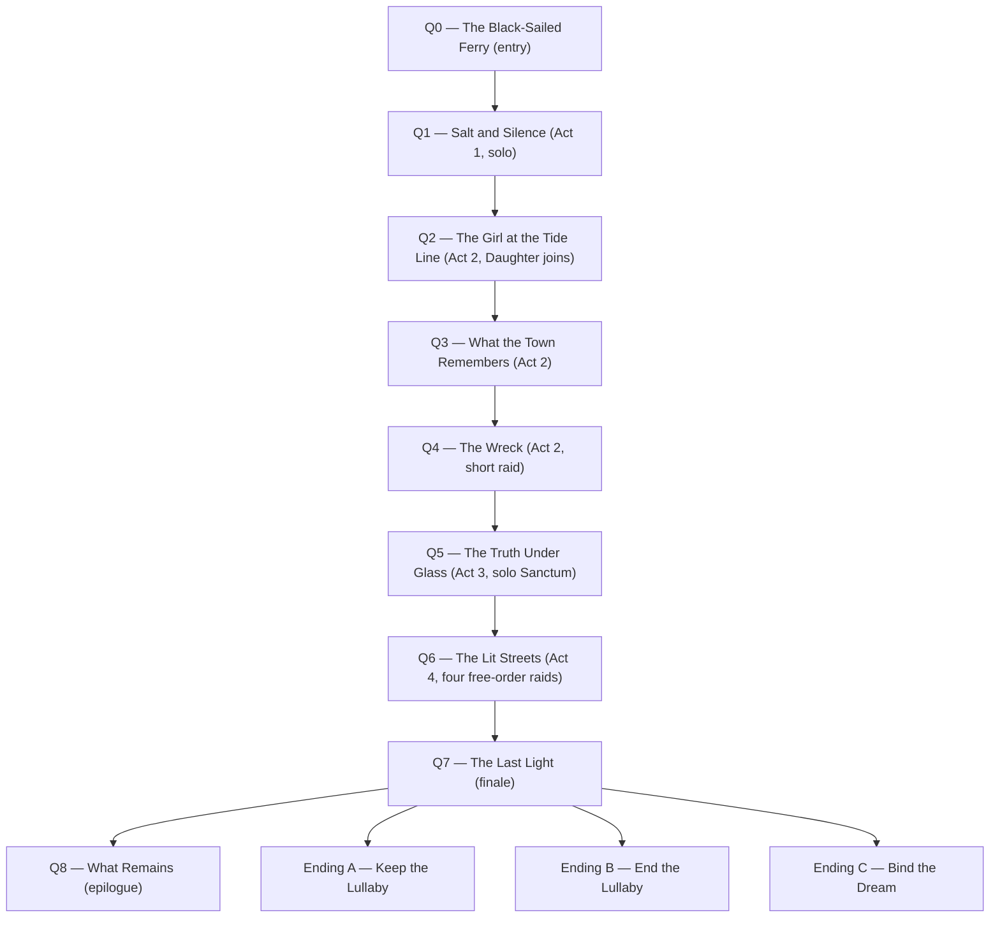

# The Drowned Lantern — Lantern Isle Questline (working title)

> *The lighthouse does not warn ships away. It calls them in.*

Status: **proposal / for review** — no code yet.
Locked 2026-11-20: the Sleeper is a **dream leviathan** (not a Bound Power); the town is
**already dead** and persists inside the dream; the companion is **the same Daughter** in
Acts 2 and 4 and becomes a **permanent ally in the Bind ending**; the **four district
raids are free order**, each revealing its own memory; the optional **repeatable night
raids** are post-arc content; the large city map uses **Option A: Text-widget drag-pan**;
the pack toggle is the **Game Rules + one-time old-save opt-in** model.

Companion docs: `quest_system_design.md` (quest runtime) · `wild_dungeon_design.md`
(site-dungeon loop) · `wonderland_quests_design.md` (state-check side quests) ·
`family_system_design.md` (Game Rules consent pattern) · `event_horizon_design.md`
(site marker + hub) · `karma_system_design.md` §17 (Game Rules framework).

---

## 1. Pitch

A black-sailed ferry offers passage from any port: no crew, no freight, no questions.
Mid-voyage the ship is pulled onto a reef below a dark lighthouse. The player wakes on a
beach where the town is alive, the market is open, and the innkeeper is already setting a
table for a festival that will happen tomorrow. It has been tomorrow for a long time.

The lighthouse is one of the **Nine Lights** — pre-Accord coastal beacons that anchored
sea-teleportation. This is the last one still burning, and it burns **inverted**: it does
not guide ships, it pulls them in. Beneath the reef, a vast **dream leviathan** sleeps, and
the beacon focuses its dream. The town, the people, and the festival are memories the
Sleeper keeps alive. Everyone is dead. The light is a lullaby.

Only one of the dead knows it. The Keeper's daughter has been lucid inside the dream long
enough to see the loop, and she asks the player to **save what is left** — not the bodies,
but the memories. The player must decide what the island becomes: a kind lie, a grave, or
a waystation between the living and the dead.

---

## 2. The player's path (plain summary)

0. **Opt in** — new characters choose the pack in the Game Rules step; old saves get a
   one-time opt-in at the ferryman. Once the arc starts, the choice is final.
1. **The ferry** — from any port city, alone. Allies are benched, cargo is stowed, the
   player's own ship stays moored. The crash is scripted, not random.
2. **Act 1 — The Shore (solo):** wake on the beach, explore the harbor, find the keeper's
   key, reach the lighthouse door, meet the Daughter at the tide line.
3. **Act 2 — The Town (Daughter):** she joins and reveals the truth. Explore the dream
   districts, gather the beacon parts, clear **The Wreck**, confront the Keeper, and
   break the illusion.
4. **Act 3 — The Truth (solo):** the town becomes the truth map and an endless night.
   The Daughter cannot follow. Descend into **The Drowned Sanctum**, defeat the
   Dream-Warden, and recover the **Lantern Anchor**.
5. **Act 4 — The Light (Daughter):** the anchor re-manifests her. Clear the four district
   shrines in **any order**; each lights its district, opens its real service, and reveals
   its own memory. Relight the lighthouse and choose the island's fate.
6. **Epilogue — Dawn:** the island becomes a hub, a grave, or a dream, depending on the
   choice. The Bind ending can make the Daughter a permanent ally.

---



---

## 3. Lore frame (proposed canon; flag anything to change)

- **The Sleeper** is a vast dream leviathan beneath the reef. It is not a god, not a Bound
  Power, and not malevolent. It dreams the drowned town from the memories of the dead.
  It has been asleep since before the Accord.
- **The lighthouse** is the aperture that focuses the dream and the lullaby that keeps the
  Sleeper asleep. While the beam burns, the town persists. The light is not a warning;
  it is a lure that feeds the dream new memories.
- **The Nine Lights** were a pre-Accord network of coastal beacons that anchored sea
  teleportation. The Accord's breaking darkened most of them; this is the last one still
  burning. The Isle of Glass's "dark lighthouse" is the network's other surviving node —
  a future lore hook, not required for this arc.
- **The Keeper** is alive. He made a pact with the Sleeper to keep his dead family
  dreaming, and he has lured ships ever since. He is the human antagonist; the Sleeper is
  the engine. He is dying, and he sees the player as a replacement anchor.
- **The Daughter** is dead and lucid. She has been awake inside the dream long enough to
  see the loop. She wants the player to end the lie. She is the Act 2 and Act 4 companion.
- **The townsfolk** are memory-echoes. They believe they are alive; routines repeat; the
  festival is always tomorrow; food has no taste. The player's Command Resonance makes
  them "solid" enough to interact, which is why they accept the player as a traveler.
- **"Save what's left"** means the memories, not the bodies. The **Town Ledger** key item
  fills as districts are lit; the endings decide what happens to those memories.
- **The island's fate = the Sleeper's sleep state.** Keep the lullaby, end it, or bind it
  to the beacon network. That is the three-ending spine.

### 3.1 What is true

| In the dream (Acts 1–2) | In the truth (Acts 3–4) |
|---|---|
| The town is alive and busy | The town is ruined and silent |
| The festival is tomorrow | The festival never happened |
| The innkeeper offers a room | The inn has no roof |
| The market sells goods | The stalls hold only salt and bone |
| The lighthouse is dark but "fine" | The lighthouse is the only thing still working |
| The Keeper is a gracious host | The Keeper is a grieving man feeding ships to a dream |

The truth does not invalidate the dream: the memories are real, the people were real,
and the grief is real. That is why "save what's left" has weight.

---

## 4. The island and the city map

### 4.1 Identity

- City id: `lantern_isle` — "Lantern Isle"; biome `lantern` (unique, so it never counts
  toward ascension / Wonderland / Pandemonium biome gates by accident).
- Hidden from the world map until the player arrives. After the arc it appears as a
  standalone node (outside the region rectangles) and becomes a beacon fast-travel
  destination.
- No normal land or sea connections. Entry is the scripted ferry; exit is the restored
  beacon. Pathfinding, wild-dungeon seeds, and the world map must skip it while hidden.

### 4.2 Map variants (same geometry)

Two ASCII maps with **identical line/column geometry** so one
`CITY_SERVICE_POSITIONS["lantern_isle"]` entry serves both:

- **Dream map** (`lantern_isle`) — bright, busy, festival banners, shops open in the art
  but closed in the act gate.
- **Truth map** (`lantern_isle_truth`) — same streets, ruined roofs, dark windows, the
  bay visible beyond the harbor.

Store variants in a new `CITY_MAP_VARIANTS` dict rather than adding keys to `CITY_MAPS`.
`verify_all_cities_mapped()` and `tests/test_city_service_positions.py` compare
`CITY_MAPS` against `CITIES`; variant keys would show as "extra maps" and break the
equality test. `get_city_map(city_id, variant=None)` checks the variant dict first.
The positions test should gain an explicit variant check (same spans for both maps).

### 4.3 Districts

| District | Shrine tag | Memory (specific to this district) | Warden | Service unlocked |
|---|---|---|---|---|
| **Harbor** | `shrine_harbor` | *The Last Ship* — the Keeper's wife begs him to let the dead go; he refuses | Drowned Sailor | Salvage shop (`shop`) |
| **Market** | `shrine_market` | *The Last Market Day* — the daughter's birthday; the town's last normal day | Hollow Merchant | Forge (`blacksmith`) |
| **Residential** | `shrine_residential` | *The Night of the Wreck* — the daughter drowns; the Keeper makes the pact | Weeping Mother | Inn (`inn`) |
| **Temple** | `shrine_temple` | *The Lullaby* — the town agrees to the dream; the Sleeper's song | The Choir | Memorial (`temple`) |
| **Lighthouse** | `beacon` | *The Keeper's Choice* — the finale | The Keeper | Beacon fast travel |

The four district raids are **free order**. Each memory stands alone; the final lighthouse
scene assembles them in a fixed order (wife → birthday → wreck → lullaby) so the story
lands regardless of clear order.

### 4.4 Act-based section locking

`CityScreen` already builds `closed_services` from `is_service_open`. Add a DLC gate:

- `lantern_phase` = `"dream_day"` (Acts 1–2), `"truth_night"` (Acts 3–4), `"dawn"`
  (post-arc).
- In `dream_day`, all real services are closed; the dream map's labels are visible but
  clicking gives a dream-line ("The stall is shuttered. It has been shuttered for years.").
- In `truth_night`, all services are closed until their district is lit. Shrines are open
  only for the current act's available districts (all four in Act 4).
- Lighting a district adds it to `player["lantern"]["lit_districts"]`; its service opens,
  its map range gains a gold "lit" tag, and its memory is recorded in the Town Ledger.
- The **Lantern Anchor** is the visual and mechanical key: lighting districts is not
  restoring the lie, it is reading the town's memory.

`CityMapWidget` already supports `closed_services` dimming; add `locked_regions` (line/col
spans per district) so the whole district dims, not only its service labels.

### 4.5 Large-map pan (Option A)

The city map is a `tk.Text`. `tk.Text` supports `scan_mark` / `scan_dragto`, so mirror the
world map's pan without a Canvas rewrite:

1. **Decouple widget height from map height.** Today `CityMapWidget` uses
   `height=self._map_lines`; a huge map pushes the action bar off-screen. Set
   `height=min(map_lines, VIEWPORT_LINES)` (e.g. 26) and let the scrollregion carry the
   rest.
2. **Pan handlers.** On `<ButtonPress-1>` → `scan_mark`; on `<B1-Motion>` → after a 4px
   threshold, `scan_dragto(gain=1)` and set cursor `fleur`; on `<ButtonRelease-1>` →
   restore cursor, and if the pointer did not drag, dispatch the service/dungeon tag.
3. **Move service dispatch to release.** Tag clicks currently fire on press. Record the
   press index; on release, if not dragged, hit-test `@x,y` with `tag_names` and dispatch
   the matching service. This is the same pan-vs-click split as
   `world_map_screen._on_canvas_release`.
4. **Only pan when needed.** Compute the content bbox; enable pan/scrollregion only when
   it exceeds the viewport. Zero the centering `lmargin1` when the content is wider than
   the viewport; keep the existing centering when it fits.
5. **Parity keys.** Home recenters; WASD/arrows pan; Tab still switches focus zones.

Keep keyboard facility navigation working. Add a Tk diagnostic for pan + click; do not
depend on pytest for the pointer behavior.

---

## 5. Dungeons and raids

### 5.1 Instances

| Instance | Act | Companion | Length | Warden | Completion reward |
|---|---|---|---|---|---|
| **The Wreck** | 2 | Daughter | 3 rooms | Drowned Quartermaster | third beacon part, stowed cargo |
| **The Drowned Sanctum** | 3 | Solo | 6–8 rooms | Dream-Warden | the Lantern Anchor |
| **Harbor Shrine** | 4 | Daughter | 3 rooms + boss | Drowned Sailor | lights Harbor; salvage shop |
| **Market Shrine** | 4 | Daughter | 3 rooms + boss | Hollow Merchant | lights Market; forge |
| **Residential Shrine** | 4 | Daughter | 3 rooms + boss | Weeping Mother | lights Residential; inn |
| **Temple Shrine** | 4 | Daughter | 3 rooms + boss | The Choir | lights Temple; memorial |
| **The Lighthouse** | 4 | Daughter | boss + choice | The Keeper | ending, hub, permanent ally |

### 5.2 Design rules

- **Short raids are 3 rooms + a memory warden.** Use the existing room generation and
  combat loop; no floor progression, no `city_floors` writes, no Pandemonium/Wonderland
  branches. A dedicated `explore_lantern_raid(player, district)` is the cleanest loop;
  the wild-dungeon loop is the template.
- **Night is an act state, not a clock wait.** `player["lantern"]["phase"]` gates the
  shrines. `truth_night` is the Act 3–4 state; the district raids are its dungeons.
  The island is a time pocket, so the global clock stays frozen; the player does not wait
  for night.
- **Free order in Act 4.** All four shrines open when Q6 starts; each completion lights
  its district and reveals its own memory. The next shrine does not depend on the last.
- **Solo Sanctum balance.** The game is tuned for parties. Give the Sanctum a solo-only
  `lantern_solo_ward` (extra max HP/damage, tuned), reduce enemy counts per room, and put
  a checkpoint before the Dream-Warden. The Daughter waits at the threshold. Do not ship a
  solo dungeon without a tuning pass.
- **Death is a loop, not an exit.** Add an island branch to `utils.apply_death_penalty()`:
  wake at the last camp/checkpoint, apply the normal penalty, never return to a mainland
  city. The dream "refuses to let you go" — thematically correct and prevents the lock
  from becoming a reset.
- **Loot.** XP/gold scaled to the player's level band (`clamp(player.level, 25, 45)`),
  materials from the island pool, no global loot-table changes. Uniques come from the
  arc, not random drops.
- **Repeatable night raids (post-arc, optional).** After the arc, the lit inn offers a
  local day/night toggle: day = services and dialogue, night = repeatable shrine raids
  for materials and a chance at district-themed gear. No story/memory repeats; tracked in
  `player["lantern"]["completed_raids"]`.

---

## 6. Quest chain

Quest IDs use the `sq_lantern_*` prefix. Definitions live in `resources/quests.py`;
runtime uses the existing `start_quest` / `update_quests` / `complete_quest` /
`queue_story` APIs. All objectives are **state-based** (`lantern_*` checks in
`progression/quests.py`) so old saves and out-of-order play never dead-end.

### Q0 — The Black-Sailed Ferry *(entry / consent)*

| | |
|---|---|
| **Giver** | The Ferryman at any port city |
| **Giver gate** | `lantern_enabled` and the arc not started/completed (not a quest `prereq` flag) |
| **Hook** | A black-sailed ferry offers passage to "the last light": no crew, no freight, no questions |
| **Play** | Warning and confirm; allies benched; cargo stowed; the ship is pulled onto the reef; wake on the beach |
| **Objectives** | `lantern_arrive:isle`, `lantern_phase:dream_day` |
| **Reward** | Flag `lantern_arrived`; starts Q1 |

The warning must state: companions cannot follow, cargo stays at the dock, the ship stays
moored, the island cannot be left until the Ninth Light burns again, and the choice cannot
be undone. Write a pre-voyage save backup (reuse the save-system backup helper).

### Q1 — Salt and Silence *(Act 1 — solo)*

| | |
|---|---|
| **Hook** | Wake on the beach. The lighthouse is dark; the town looks alive; the ferry is gone |
| **Play** | Explore the beach and harbor, survive the first encounter, find the keeper's key, reach the lighthouse door, meet the Daughter at the tide line |
| **Objectives** | `lantern_site:beach`, `lantern_site:harbor`, `lantern_site:lighthouse_door`, `lantern_companion:met` |
| **Reward** | `keepers_key`; flag `lantern_act1_done`; starts Q2 |

### Q2 — The Girl at the Tide Line *(Act 2 — Daughter joins)*

| | |
|---|---|
| **Hook** | She tells the player she is dead and the town is a dream. She asks the player to save what is left |
| **Play** | Follow her through the harbor and market; talk to the Keeper; notice the routines repeat |
| **Objectives** | `lantern_companion:joined`, `lantern_site:market`, `talk_npc:lantern_keeper` |
| **Reward** | Daughter joins as a temp ally; flag `lantern_truth_known`; starts Q3 |

### Q3 — What the Town Remembers *(Act 2 — dream districts)*

| | |
|---|---|
| **Hook** | The beacon needs three parts. Two are hidden in the town's memories; the third went down with the ferry |
| **Play** | Explore the dream districts, gather the lens and wick through dialogue/stat checks, learn the town's last day |
| **Objectives** | `lantern_part:lens`, `lantern_part:wick`, `lantern_site:temple` |
| **Reward** | Two beacon parts; flag `lantern_dream_parts`; starts Q4 |

### Q4 — The Wreck *(Act 2 — short raid)*

| | |
|---|---|
| **Hook** | The ferry's wreck lies on the reef; the last part is in the captain's safe |
| **Play** | 3-room raid; Drowned Quartermaster; recover the frame and the stowed cargo |
| **Objectives** | `lantern_raid:wreck`, `lantern_part:frame` |
| **Reward** | Third part; stowed cargo; flag `lantern_wreck_cleared`; starts Q5 |

This is the tutorial for the Act 4 raid loop.

### Q5 — The Truth Under Glass *(Act 3 — solo)*

| | |
|---|---|
| **Hook** | The Keeper confronts the player; the illusion breaks; the town becomes the truth map and an endless night. The Daughter cannot follow |
| **Play** | Descend into the Drowned Sanctum (6–8 rooms), solo ward active, defeat the Dream-Warden, recover the Lantern Anchor |
| **Objectives** | `lantern_phase:truth_night`, `lantern_raid:sanctum`, `lantern_boss:dream_warden`, `lantern_anchor:held` |
| **Reward** | `lantern_anchor`; flag `lantern_act3_done`; starts Q6 |

The anchor is inert until the four district shrines are lit; it does not become an exit
yet.

### Q6 — The Lit Streets *(Act 4 — free order)*

| | |
|---|---|
| **Hook** | The anchor re-manifests the Daughter. Four district shrines are open, each holding a memory and a piece of the beacon |
| **Play** | Clear the four district raids in any order. Each lights its district, opens its service, and reveals its specific memory |
| **Objectives** | `lantern_district:harbor`, `lantern_district:market`, `lantern_district:residential`, `lantern_district:temple` |
| **Reward** | All districts lit; flag `lantern_all_lit`; starts Q7 |

Free order is intentional. Each memory is self-contained; the final scene orders them.

### Q7 — The Last Light *(Act 4 — finale)*

| | |
|---|---|
| **Hook** | The lighthouse opens. The Keeper makes his stand; the Sleeper stirs |
| **Play** | Lighthouse boss/gauntlet; the Keeper's final choice; the three-way beacon choice |
| **Objectives** | `lantern_site:lighthouse`, `lantern_boss:keeper`, `lantern_choice:made` |
| **Reward** | Ending flag; starts Q8 |

### Q8 — What Remains *(epilogue)*

| | |
|---|---|
| **Hook** | Dawn. The island's fate is decided |
| **Play** | Ending scenes; hub unlock; the Daughter's fate; rewards |
| **Objectives** | `lantern_epilogue:seen` |
| **Reward** | Ending items; hub; permanent ally in the Bind ending |

---

## 7. The Daughter

- **Identity:** the Keeper's daughter; dead, lucid, a dream-construct. Working id
  `lantern_daughter`; display name TBD.
- **Combat kit:** light/water support (tide hymn, lantern ward, memory flare). Auto-scaling
  spectral gear like the Wonderland temp heroines; no house record, no gear management
  while temp.
- **Act 2:** joins as `_lantern_temp: True`, `_lantern_key: "daughter"`.
- **Act 3:** removed from `player["allies"]` and stored in
  `player["lantern"]["companion_bench"]`; she cannot enter the Sanctum. Do not send her to
  the house.
- **Act 4:** restored from the bench when the Lantern Anchor is held.
- **Bind ending:** converted to a permanent story ally (`_lantern_temp: False`), added to
  the roster/bench with capacity handling, excluded from capture/collection counts.
  Use the unique-story-ally persistence pattern (house record + identity key, like the
  permanent Wonderland heroines).
- **Keep ending:** she stays in the dream.
- **Release ending:** she passes on; grant a keepsake key item.
- **Roster hygiene:** add `_lantern_temp` to the exclusions in `_recruit_ally_keys` /
  `compute_roster_tier`, `dismiss_allies_back_to_house`, family/house-story scans, and
  dispatch. A temp companion must never inflate Command Resonance or appear in the house.

---

## 8. The Keeper and the finale

- **The Keeper** is the human antagonist: alive, grieving, and feeding ships to the dream.
  He believes he is keeping his family alive. He wants the player to replace him as the
  anchor.
- **The Dream-Warden** guards the Sanctum; it is the dream's immune response, not the
  Keeper.
- **The Sleeper** is never fought directly. It is the environment, the bay, and the
  lullaby. The finale is the Keeper and the choice, not a kaiju battle.

| Ending | Choice | The Keeper | The Daughter | The island |
|---|---|---|---|---|
| **A — Keep the Lullaby** | Keep the beacon burning | Remains keeper, grateful and guilty | Stays in the dream, unable to rest | A hidden dream-hub; the dead persist |
| **B — End the Lullaby** | Let the light go out | Dies with the dream, or leaves broken | Passes on; a keepsake remains | Real and empty; a memorial; the Sleeper stirs |
| **C — Bind the Dream** | Anchor the dream to the network | Becomes the mortal keeper of a true beacon, redeemed | Can leave with the player (permanent ally) | A true waystation; the dead may choose |

The Bind ending requires all four districts lit and the Town Ledger filled. It is the
"save what's left" ending: the memories become the island's foundation.

---

## 9. Items and rewards

### Key items
- `lantern_anchor` — recovered in the Sanctum; inert until the four districts are lit;
  after the finale it registers Lantern Isle as a beacon destination (mirror the
  `glass_anchor` pattern in `facilities/arcane_tower.py`).
- `town_ledger` — fills with one memory per lit district; the Bind ending requires it.
- `keepers_key` — opens the lighthouse door.
- `daughter_keepsake` — Release-ending only.

### Uniques (actor-based for player + allies)
- `saltglass_hook` — weapon; water/light; bonus against drowned/undead.
- `lullaby_bell` — accessory; once per combat, a chance to daze/sleep enemies at the
  start of the fight.
- `keepers_lantern` — accessory; light damage and a small defensive heal; reveals hidden
  paths on the island.

Implement each with the standard `combat/weapon/<name>.py` module, `_actor_has_<id>`,
and wiring into both `combat/player_actions.py` and `combat/ally.py`. Clear state in
`end_of_combat_cleanup()`.

### Materials
`wreck_salt`, `beacon_glass`, `siren_pearl`, `salt_iron` — island-only drops, spent at the
lit forge. Do not add them to global loot or shops.

### Optional unique ship
A "Lantern Ketch" reward is tempting but touches the shipyard tier model. Park it as an
open call; the core reward is the hub + permanent ally + uniques.

---

## 10. DLC toggle and content containment

### Toggle
- Add `lantern_enabled` to `character.GAME_RULES`:
  `default_new: False`, `default_old: False`, `locked_after_creation: True`,
  `implemented: True`.
- `ensure_player_fields`: `player.setdefault("lantern_enabled", False)`.
- `build_character`: write `rules["lantern_enabled"]`.
- `char_create_screen._build_game_rules()`: add the pack card (the current function
  hardcodes Karma/Family; either add a third card or refactor to loop bool rules).
- **Old saves:** one-time opt-in at the ferryman. Once accepted, final. No mid-arc
  disable — it would have to delete state, items, and temporary allies, the same failure
  mode the family system avoids.

### Containment
- All new items, enemies, and services are obtainable **only on the island**.
- No global shop/loot/wild-reward changes.
- The only global additions: the Game Rules row, the ferryman button, the hidden city
  entry, and the quest auto-start guard.
- Gate points: ferryman, `_sync_lantern_quests`, map visibility, island services, and
  pack-tagged content validation.
- Add a `pack: "drowned_lantern"` field to pack items/quests and a test asserting they
  are only reachable through pack content.

---

## 11. Systems mapping

| File | Change |
|---|---|
| `resources/cities.py` | `lantern_isle` entry (biome `lantern`, hidden, no travel connections, services, dialogue) |
| `resources/city_maps.py` | dream map, `CITY_MAP_VARIANTS["lantern_isle"]["truth"]`, shared `CITY_SERVICE_POSITIONS`, `get_city_map(city_id, variant=None)` |
| `resources/world_layout.py` | `CITY_POSITIONS["lantern_isle"]`; keep it out of `REGIONS` so the region rectangles do not expand |
| `gui/widgets/city_map.py` | `map_variant`, `locked_regions`, Text-widget drag-pan, release-based tag dispatch, viewport height cap |
| `facilities/lantern_beacon.py` | new beacon handler: exit/fast-travel after the arc, dawn-hub services |
| `gui/screens/city_screen.py` | act gate in `closed_services`, map variant, shrine/dungeon tag handling, island arrival guards (Karma/story/EH), conditional docks button |
| `gui/screens/world_map_screen.py` | `is_city_visible` filter; hidden node until arrival; beacon destination after the arc |
| `facilities/pathfinding.py` | exclude hidden cities from destinations/routing |
| `world/wild_dungeons.py` | exclude `lantern_isle` from seed cities |
| `facilities/lantern_ferry.py` | new ferryman facility: warning, opt-in, bench/stow, scripted crash |
| `world/city.py` | register `lantern_ferry` (optional if the button calls the handler directly) |
| `resources/quests.py` | 9 quest definitions `sq_lantern_00`–`sq_lantern_08` |
| `progression/quests.py` | `lantern_*` state checks, `_sync_lantern_quests`, act transitions |
| `core/character.py` | `GAME_RULES` row, `ensure_player_fields` defaults, `lantern` state, `build_character` |
| `gui/screens/char_create_screen.py` | Game Rules pack card |
| `combat/ally.py` | daughter creation, `_lantern_temp` exclusions, permanent conversion |
| `core/utils.py` | `apply_death_penalty` island branch (wake at camp) |
| `world/dungeon.py` | `explore_lantern_raid` and `explore_lantern_sanctum` |
| `gui/screens/dungeon_screen.py` | lantern raid branding/floor labels |
| `resources/items.py` | key items, materials, uniques |
| `combat/weapon/*.py` | unique item effects |
| `combat/lantern_keeper.py`, `combat/lantern_dream_warden.py` | boss modules + YAML entries + tier pool |
| `tests/test_city_service_positions.py` | variant/geometry checks, new keywords (`SANCTUM`, `SHRINE`, `BEACON`) |
| `tests/_diag_lantern.py` | toggle, ferry, bench/stow, acts, free-order districts, memories, endings, permanent ally |

### State schema

```python
player["lantern"] = {
    "started": False,
    "act": 0,                 # 0 not started, 1-4, 5 epilogue
    "phase": "dream_day",     # dream_day | truth_night | dawn
    "arrived_day": 0,         # island-local day counter
    "companion": "unmet",     # unmet | joined | benched | returned | permanent
    "parts": [],              # lens / wick / frame
    "anchor": False,
    "lit_districts": [],      # harbor / market / residential / temple
    "memories": [],           # district memory ids
    "choice": None,           # keep | release | bind
    "completed_raids": 0,     # post-arc repeatables
    "day_phase": "night",     # post-arc local cycle (optional)
}
```

Top-level companion/cargo storage mirrors Wonderland:
`lantern_benched_allies`, `lantern_stashed_cargo`, `lantern_saved_companion`.

### City-map test gotcha
`tests/test_city_service_positions.py` requires a `dungeon` position for **every** city.
Give `lantern_isle` a `dungeon` tag labelled `SANCTUM` (and add `SANCTUM` to the keyword
map), handled by the DLC dungeon branch — or add an explicit island exception to the test.
Do not leave the city without a `dungeon` span.

### Threading and notifications
- Ferry, raids, and facilities run on background threads: `_tprint` / `_tpause` /
  `_tinput` (or `c_print` / `c_input` in combat). Never raw `print()` / `input()`.
- Quest updates and memories surface via the **Journal + session log**, never toasts.
- Big reveals use `queue_story` / `StoryScreen`.
- Time: freeze global time on arrival (`lantern_time_frozen`), restore on exit; advance
  only `lantern.arrived_day` on rest. Monthly bills/dispatch deadlines are paused.

---

## 12. Build phases

| Phase | Content |
|---|---|
| **0** | Game Rules toggle, ferryman, crash, `player["lantern"]` state, warning/backup, ally bench/cargo stow, death/camp loop |
| **1** | Act 1 shore/harbor/lighthouse + dream map + Text-pan patch + district gate |
| **2** | Act 2 Daughter, dream districts, The Wreck raid, Keeper confrontation, illusion break |
| **3** | Act 3 truth map, Drowned Sanctum solo dungeon, Dream-Warden, Lantern Anchor |
| **4** | Act 4 four free-order shrine raids, lit services, lighthouse finale, three endings |
| **5** | Dawn hub, permanent ally, optional repeatable night raids, uniques, wiki/changelog |

---

## 13. Verification

- `tests/_diag_lantern.py`: toggle, old-save opt-in, ferry bench/stow, act transitions,
  free-order districts, memory ledger, anchor gating, all three endings, permanent ally.
- `tests/test_city_service_positions.py`: variant maps share spans; new city/services
  validate; no keyword regressions; the `dungeon` position is present and labelled
  `SANCTUM`.
- Tk diagnostic for the Text-pan click-vs-drag behavior (pytest Tk is flaky in this
  environment).
- Old-save smoke test against `savefile_1` read-only: load, verify `lantern_enabled`
  defaults False and no island state leaks.
- Full suite: `.venv\Scripts\python.exe -m pytest` from the repo root.
- Fresh-process import check and cycle check after adding the new modules.

---

## 14. Decisions & open calls

### Locked (2026-11-20)
1. The Sleeper is a **dream leviathan**, not a Bound Power.
2. The town is already dead; the lighthouse/ dream persists them; the companion is dead
   and lucid.
3. The Daughter is the **same companion** in Acts 2 and 4.
4. The Daughter becomes a **permanent ally in the Bind ending**.
5. The four district raids are **free order**; each reveals its own memory.
6. **Repeatable night raids** are optional post-arc content.
7. The large map uses **Option A: Text-widget drag-pan**.
8. The pack uses the **Game Rules + one-time old-save opt-in** toggle model.

### Still open
- **Name** — pack/questline/city/companion display names (working: *The Drowned Lantern*,
  Lantern Isle, the Daughter).
- Whether the optional **unique ship** reward ships, or the hub + ally are the reward.
- Whether the Daughter's permanent form uses auto-scaling spectral gear or player-issued
  gear.
- Whether the Keeper is redeemable in all endings or only in Bind.
- Whether repeatable raids grant only materials or also a slow lore/codex trickle.

---

*Everything in §3–§9 beyond cited canon is proposed and safe to cut. The quest structure
is designed to survive edits to the lore frame.*
